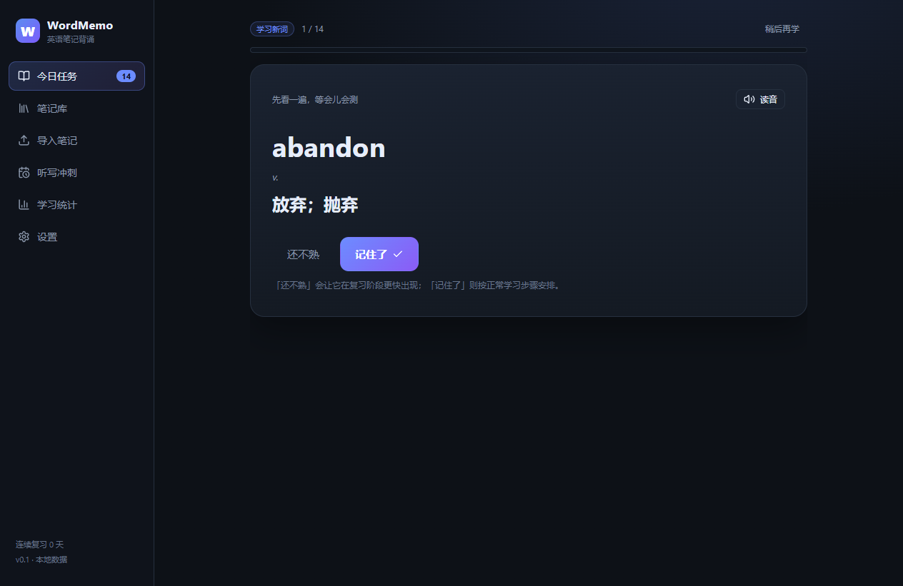

# WordMemo · 英语笔记背诵工具

把老师的英语笔记（图片 / txt / md / docx / xlsx）变成结构化词条库，用 **FSRS** 安排长期复习，用**听写日期倒排**生成冲刺计划，用 **DeepSeek / OpenAI / Gemini / GLM** 做识别、校验、语义判分和搭配补充，发音自动抓取并缓存到本地。



## 启动

双击 **`WordMemo.exe`**（可以右键发送到桌面快捷方式）。

- 这是本地编译的小启动器，直接拉起 Electron，不经过 VBS / CMD
- 没有“来自 Internet”的安全警告，也不会有控制台闪窗
- 参数里已经带了 `--no-sandbox`
- 首次使用先到 **设置 → 左侧「AI 供应商」** 填一个 Key（默认 DeepSeek）

> **为什么需要 `--no-sandbox`？**
> 这台机器的 Chromium 沙箱初始化会被环境拦截，Electron 不带这个参数会在窗口出现前直接退出（事件日志 `0xc0000005`）；加上之后即使极域电子教室在运行也正常。应用本身仍然保持 `contextIsolation: true`、`nodeIntegration: false`，只加载本地页面。

如果启动器失效（例如项目目录被移动），先运行 `scripts\build-launcher.cmd` 重新生成，或双击 `调试启动（控制台）.bat` 查看错误。**不要直接双击 `node_modules\electron\dist\electron.exe`**。

> **关闭窗口不等于退出**：点 × 只是把窗口收进托盘，应用仍在后台跑（到期提醒依赖它）。另外应用是单实例的，旧进程还在时再双击 `WordMemo.exe` 只会把旧窗口叫出来，**不会加载新代码**。
>
> 所以改完代码 / 更新构建后，必须从 **侧边栏底部「退出」**、**设置 → 后台与退出 → 退出应用** 或 **托盘右键 → 退出** 真正退一次，再重新双击 `WordMemo.exe`；也可以直接用 **托盘右键 →「重启应用（加载新版本）」**。
>
> Windows 11 会把新托盘图标收进任务栏右下角的「^」里；找不到图标时，用上面两个应用内入口退出即可。

> **托盘图标完全不出现？先看 D 盘目录的完整性标签**：本项目目录曾被标成 `Low Mandatory Level`，而任务栏 Explorer 是 `Medium`，Windows 的 UIPI 会拒绝低权限进程注册托盘图标（Electron 日志：`Unable to create status tray icon`）。修复方式（管理员）见文末「已知限制」里的 `repair-integrity.cmd`。侧边栏现在会显示 **构建时间 / 启动时间 / 权限级别 / 托盘状态**，设置页也有「重新检测」，一眼就能判断是没启动、低权限还是被 Windows 收进 `^`。


## 功能

- **笔记库**：SQLite 单文件，支持按单词/释义/笔记全文搜索；搜索时同时列出“匹配的词条”和包含它的笔记，按上课日期或导入时间排序。
  - **一个单词只保留一个词条**：`resemble` 被一份笔记识别成 word、另一份识别成 phrase，或者 `nudge` 一份是 v.、一份是 n.，都会合并成一个词条；词性合并为 `v. / n.`，释义/搭配/例句取并集
  - 已有重复词条会在启动迁移时自动合并，笔记关联、卡片和复习记录会尽量保留
  - 中文查询先本地匹配；没有命中任何词条时，才把**查询词本身**发给 AI，扩展成 3~5 个常见英文词，再在本地检索
  - AI 不会拿到整个词库；扩展结果不永久缓存，换个同义表达会重新判断
  - 点击笔记可以查看里面的词条；点击单词本身或右侧 👁 按钮，打开**词条详情**：英文、音标、美音/英音、词性、中文释义、固定搭配、例句、用法备注、学习状态
  - 词条的**全部字段都能编辑**：类型（单词/短语/句子/语法）、英文、词性、音标、中文释义、固定搭配、例句（可增删）、备注；改英文/词性/类型会重算去重键，撞词会提示失败
  - 笔记详情底部有「**重爬音标**」：忽略内存缓存，把这份笔记里所有词条的音标重新查一遍并覆盖（含手动改过的）；单词查词典，词组和查不到的词交给 AI 拼读，完成后提示更新/没查到的条数
- **导入**
  - 图片（PNG/JPG/JPEG）：AI 视觉识别（默认 DeepSeek，可在设置里单独指定）。模型先判断这一页有几栏，再给每一行标上所属栏号；客户端按栏号重排，阅读顺序由代码保证，不靠模型自觉（同一提示词两次识别，模型有时会把左右栏同一高度的两行拼成一行，实测概率接近一半）。单栏、左右两栏、三栏都走同一套逻辑
  - 一行里并排写了两个词条（`assess v.评估 assessment n.评估`）会自动拆成两条；`resemble = imitate` 取 `resemble` 作词头，`= imitate` 记进备注
  - Word：mammoth 解析；Excel：ExcelJS 解析；txt：自动识别 GBK/UTF-8；md：直接读取
  - **识别完立刻落草稿**：解析成功就写进 SQLite，关窗口、切页面、重启应用都不会丢；只有点「入库」或手动「丢弃」才删除
  - 可以一次拖入多张图 / 多个文件，逐份编辑、逐份入库；入库后**留在导入页**自动切到下一份，其余草稿不受影响，也可以「全部入库」
  - 同一份文件重复导入会直接恢复旧草稿，不再调用 AI（同时也命中已有的 AI 缓存）
  - 未入库数量显示在侧边栏「导入笔记」角标、笔记库顶部提示条和托盘菜单；每次启动提醒一次
  - 草稿永久保留，导入页「草稿管理」可以看占用、逐份打开或全部丢弃
  - 入库前 AI 校验：拼写、词性、释义不匹配、OCR 乱码、重复词条，逐条黄色标记 + 修改建议；点「定位」会跳到对应词条并闪烁 2 秒
  - 改完词条可以点「重新校验」按当前内容重跑一次 AI 校验（只有点按钮才产生新 token）
  - AI 自动补充常用固定搭配和例句；已有笔记可在详情里点「AI 补充搭配」补全
  - **入库时补全音标**：单词先查词典，查不到的词和所有词组整批交给 AI 标注（美式在前、英式在后）；期间显示居中进度弹窗；音标查询失败不影响入库
- **今日任务**：先学新词，再复习旧词
  - 新导入的笔记会进入「待学习」，按**词条**计入每日上限（默认 20 个/天）
  - 学习时先看单词、音标、多个词性、释义、固定搭配、例句和发音，点「记住了 / 还不熟」
  - 进入今日任务后会后台预取当天新词的音标（3 个并发，查到后写回词条），学到时通常已经准备好
  - 「听→写」不显示英文；点「提示：词性 + 中文」后显示词性和中文释义，方便不方便听发音时也能写出来
  - 学完立刻进入测验复习；「还不熟」的词会排在复习队列前面
  - 所有测验结果都会写回 FSRS，决定下次间隔
- **复习**
  - 每个词条 2~3 张卡：`英→中`、`中→英`（必选）、`听→写`（可全局或逐词关闭）
  - 每张卡独立 FSRS-7 记忆状态，间隔由 `ts-fsrs` 计算（与 Anki 同一套 FSRS）
  - **同词条 sibling bury**：一次只随机出一个方向，另外两个方向当天 bury，第二天再参与
  - 学习步骤按 Anki 的方式处理：答错/学习中的卡在本轮内再次出现；本轮结束前会提前学习 `learnAheadMinutes`（默认 20 分钟）内到期的学习卡，不用手动进入下一批
  - 复习队列先出刚学完待检测的词，再按预测遗忘概率从高到低排
  - 测验只考单词/释义，固定搭配和例句在答案揭晓后展示
  - 复习界面**默认不显示音标**；卡片右上角有「音标提示」，点开后显示音标，再点隐藏。音标只作为区分同义词（如 assess / evaluate）的提示，**看不看都不影响 FSRS 评分**
  - 如果词条没有音标，点「音标提示」会按需查询：先 Free Dictionary API，查不到再用有道 JSON 补一次；查到后写回词条，失败时提示手动补充
  - 中文答案先查本地词库/同义项，命中就不花 token；不命中才调 AI 判语义
  - AI 判定分三档：命中本词条释义 = 绿色正确；词本身有学生写的这个义项、但词条没收录 = 黄色「跳出舒适圈」，不判错，可按 Hard 继续；完全没有这个义项 = 红色错误
  - 「中→英」「听→写」先做本地拼写比对（含英式/美式、连字符、`to` 前缀等价），命中直接算对；**不命中再交 AI 判断是不是同一个表达**：括号里的可选词（`be (fully) bathed in`）、`...`/`sb.`/`sth.` 占位符、缩写与完整形式（`I'm` = `I am`）都算对；**拼写错一个字母也判错**（`contemporary` 写成 `contemprary` 不算对，能猜出是哪个词也不算），同义词或换说法同样判错。未配置 Key 或关闭 AI 判分时，退回原来的严格判错，不改变离线体验
  - **想不起来可以输入「不知道」或「XXX」**（大小写、全角、结尾标点都认）：不查词条、不匹配、不调 AI，直接按错误计入 FSRS（Again）；输入框下方有小字提示。刻意只认这两种写法——有些词条的意思就是“不记得”，放宽会误伤正常作答
- **听写冲刺**：设置听写日期，按剩余天数、每日分钟数自动分配任务，给出「预计考试日记忆率」和来不及的提醒；同一个词一次也只出一道方向题。
- **长期记忆**：冲刺复习同样写入 FSRS 历史，考完自动回到长期轨道。
- **发音**：有道 → 百度 → Free Dictionary API → 系统语音，四级回退，mp3 落盘缓存；词条详情里可以分别试美音和英音。
- **提醒**：系统通知 + 托盘菜单 + 开机自启（设置里开启）。
- **后台与退出**：侧边栏底部显示**构建时间、启动时间、权限级别和托盘状态**；设置 →「后台与退出」提供「重新加载界面 / 重启应用 / 退出应用 / 重新检测」，托盘菜单也有「重启应用（加载新版本）」；关闭窗口时第一次会提示应用仍在后台运行。诊断细节写在 `.data/diagnostics.log`。

## 首次配置

1. 申请一个 Key（四家任选，也可以都填）：
   - DeepSeek：[platform.deepseek.com](https://platform.deepseek.com/api_keys)（默认）
   - GLM：[open.bigmodel.cn](https://open.bigmodel.cn/)（国内可直连）
   - OpenAI：[platform.openai.com](https://platform.openai.com/api-keys)（大陆需要代理）
   - Gemini：[aistudio.google.com](https://aistudio.google.com/apikey)（走官方 OpenAI 兼容层）
2. 设置 → AI 供应商 → 选中那家 →「配置」→ 粘贴 Key → **保存并测试**（会显示延迟与模型回显）
   - 模型从目录里搜：显示公开名（如 `DeepSeek-V4.1-Flash`），真正发给 API 的是后面的 id（如 `deepseek-flash`）；也可以直接手填
3. 在同一页的「AI 角色与预算」里选默认模型；图片识别可以单独指定另一家
4. 建议保持默认：长期保留率 0.90、冲刺 0.95、每天 20 个新词、20 分钟预算

Key 只保存在本机（Windows DPAPI 加密），不会上传；价格来自 models.dev（未知模型显示「费用未知」并只统计 token）。**金额是估算，可能和账单有出入。**费用参考：一张图片识别约 0.005 元，一次语义判分约 0.0007 元；导入时还会批量补充固定搭配、例句和词组音标，100 个词约几分钱。

## AI 供应商与验证状态

| 供应商 | 状态 | 说明 |
|---|---|---|
| DeepSeek | **已验证** | 作者在真机上跑通了设置页测试、导入结构化、复习判分、费用统计 |
| GLM（智谱） | **待验证** | 配置按官方文档写；申请到额度后会用 `npm run ai-smoke` 跑一遍再改这里 |
| OpenAI | **未验证** | 作者没有该地区账号（无 VPN / 虚拟信用卡）；401/403/404 的提示已经按「该改什么」写好 |
| Gemini | **未验证** | 同上；JSON 模式按 prompt-only 处理，`/models` 走 native 端点（`x-goog-api-key`） |

设置页分成 6 个分区（左侧点、右侧改）：**AI 供应商 / AI 角色与预算 / 复习节奏 / 提醒 / 发音源 / 高级与诊断**；备份、打开数据目录、版本、后台运行与排障都在最后一节。

自检：`npm run ai-smoke`（4 个调用点 × 4 家，没配 Key 的家显示 `SKIP（无 Key）`，会花掉几次极短调用）。跑之前**先退出正在运行的应用**（单实例锁会挡住它：托盘右键 → 退出）。报错时在设置页点「复制诊断信息」，粘出来的内容不含 Key。

> 四家共用同一个 OpenAI 兼容传输层，差异只在 `src/main/ai/providers.ts` 的一张表里；某家参数不认会**自动去掉该参数重试一次**，所以配错模型名/位置受限时通常只是那一家失败，不影响别家。

## 数据与备份

- 开发运行时数据在项目下 `.data/`；打包后使用 `%APPDATA%/WordMemo/`
- 数据库：`wordmemo.db`（SQLite，WAL 模式）
- 原图/原文件：`files/`（**解析那一刻就复制进来**，所以未入库草稿的原图也不会丢）
- 未入库草稿：`wordmemo.db` 的 `import_drafts` 表，随数据库一起备份；永久保留，直到入库或手动丢弃
- 发音缓存：`media/tts/`
- 备份：设置 → 数据 → 立即备份；启动时每天自动备份一次，保留最近 7 份
- 删除笔记会同时删除它的复习进度和不再被引用的词条，操作前会二次确认

## 开发

```bash
npm install
npm run dev          # Electron 开发模式（已带 --noSandbox）
npm run build        # 构建 Electron 版
npm run dist         # 打包 Windows 安装包
npm run typecheck
npm test             # Vitest：SQLite / FSRS / 判分 / 计划器
```

重新生成启动器：

```bat
scripts\build-launcher.cmd
```

技术栈：Electron 38.8.6（Chromium 140 / Node 22）、React 19、TypeScript、`ts-fsrs` 6（FSRS-7）、`node:sqlite`（零原生编译）、Vite。

> Electron 从 45 降级到 38.8.6：两个版本在本机的沙箱环境下都会在 `ready` 前崩溃，38 更保守；`ts-fsrs` 在 Node 22.22 下实测可用。
>
> 打包后的 exe 同样需要 `--no-sandbox`：如果做安装包，请给启动快捷方式或外层启动器补上 `--no-sandbox`。

## 目录结构

```
src/
  main/          Electron 主进程 + 所有业务逻辑
    db/          SQLite 连接、表结构、仓储（importDrafts.ts = 未入库草稿）
    ai/          供应商表、传输层、目录与价格、提示词、导入校验
    importers/   图片/文档解析与结构化（ingest.ts = 解析即落草稿）
    media/       发音下载与缓存
    storage.ts   原始文件按 sha256 落盘与副本清理
    planner.ts   听写冲刺计划器
    fsrs.ts      ts-fsrs 封装（不重写算法）
    search.ts    本地搜索 + 中文查询的 AI 语义扩展
  preload/       contextBridge 白名单
  renderer/      React 界面
  shared/        类型、归一化、日期工具
tests/           Vitest 集成测试
scripts/         图标生成、启动器 Launcher.cs / build-launcher.cmd
```

## 测试

`npm test`：25 项集成测试，覆盖文本解析、多词性、跨词性/类型去重、建议清理、音标显示、词条去重、固定搭配、单向抽卡与去重计数、当天单批次、判分、FSRS 复习、冲刺计划、统计，以及草稿持久化（重开数据库仍能恢复修改）、入库/丢弃、同一文件不重复识别、多文件入库后其余草稿不丢。

另外用 Electron 调试端口做过真实窗口验证：导入 `samples/demo.txt` → 学习新词 → 每个词随机抽 1 个方向 → 提交并写回 FSRS → 删除清理；并在真实词库验证了中文语义搜索（“允许” → AI 扩展 → 找到 permit）、点击单词打开词条详情、以及复习队列每个词只出现一次。草稿功能上线时还验证了：导入页顶部草稿卡片带、自动保存后重新进入仍在、丢弃后回到空态、侧边栏构建时间，以及「退出应用」IPC 能真正结束进程。

## 已知限制

- **本机 Electron 必须带 `--no-sandbox`**：Chromium 沙箱初始化会被当前环境拦截，不带参数会在窗口出现前崩溃；`WordMemo.exe` 启动器已带该参数。应用仍保持 `contextIsolation` 和 `nodeIntegration: false`。
- **关闭窗口只是收进托盘**：应用不会退出，再次双击 `WordMemo.exe` 也只会叫出旧实例（单实例锁），不会加载新构建。更新后请用侧边栏「退出」、设置 →「退出应用」或托盘右键「退出 / 重启应用」。
- **Windows 11 托盘图标可能收在「^」里**：这是系统对新手图标的分组策略，不是应用没启动；用应用内的退出入口即可，也可以在「设置 → 个性化 → 任务栏 → 其他系统托盘图标」里把 WordMemo 设为常显。
- **D 盘项目目录带 Low 完整性标签会让托盘彻底失效**：`icacls D:\ymh\Code\tools\wordmemo` 显示 `Mandatory Label\Low Mandatory Level`，目录里的 `WordMemo.exe` / `electron.exe` 会以 Low 运行；任务栏 Explorer 是 Medium，Windows 的 UIPI 必然拒绝注册托盘（Electron 日志 `Unable to create status tray icon`）。修复：右键 `repair-integrity.cmd` →「以管理员身份运行」，只把这两个 exe 的标签改成 Medium，不动目录和其他文件。以后重装/升级 Electron 后需要重跑一次。验证：`icacls ...\WordMemo.exe` 应显示 `Medium Mandatory Level`，侧边栏权限应显示「正常权限」。
- 如果环境里存在 `ELECTRON_RUN_AS_NODE=1`，直接运行 electron.exe 会进入 Node 模式并一闪而过；用 `WordMemo.exe` 或 `调试启动（控制台）.bat` 启动。
- 有道/百度发音是网页接口，非官方、可能限流；已做本地缓存和系统语音兜底，仅建议个人使用。
- 手写体识别取决于字迹，导入页保留原图对照和黄色核对标记；识别不准时请手动改。整页图在模型侧只值约 1020 个视觉 token（实测），字迹很淡或很小的行仍可能认错，这是分辨率上限，不是提示词能补的。
- **音标默认不显示**：词条详情里始终可见；复习卡片上需要手动点「音标提示」，再点隐藏。音标来自笔记原文、详情页手动补充，或复习时按需查询（Free Dictionary API → 有道 JSON 回退）；原文没有且查询失败时显示“暂无音标”。
- **learn ahead 默认 20 分钟**：如果把它调得很小，1 分钟后到期的学习卡可能要在重新进入时才出现；默认值下会在本轮内提前学掉。
- **入库时会补全音标**：单词先查词典，查不到的词和所有词组整批交给 AI，返回美式在前、英式在后的 IPA；复习时点「音标提示」仍会按需查询，词组回退到逐词拼接（缺失词用 `…` 占位，不写回词条）。
- 图片 OCR、AI 校验、AI 搭配补充、AI 语义判分、AI 词组音标都需要有效的 AI Key 和网络；断网或 Key 失效时，文本类文件仍可解析，本地词库判分仍可用。
- AI 补充的固定搭配和例句由模型生成，极少数可能不够地道；觉得不合适可以直接在词条编辑里改掉。
- 不直接连接 Anki：调度使用 `ts-fsrs`（与 Anki 同一套 FSRS），复习交互借鉴 Anki 的 sibling bury 和预测遗忘概率排序；没有做 AnkiConnect / Anki 库同步。
